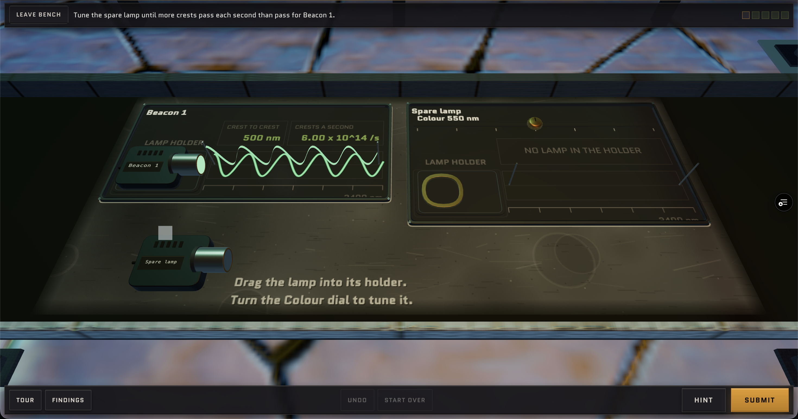
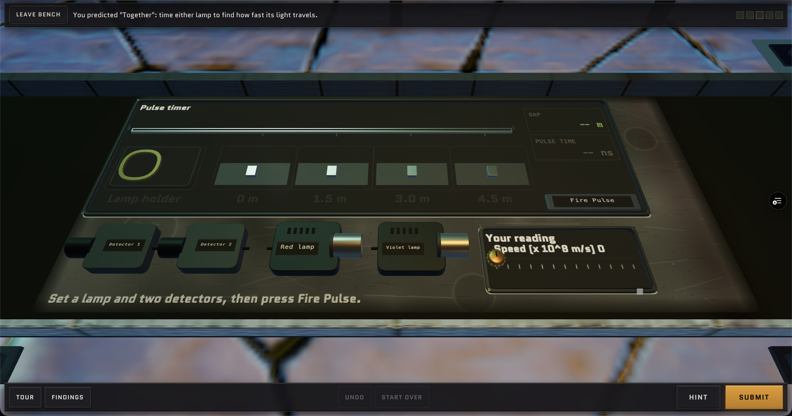
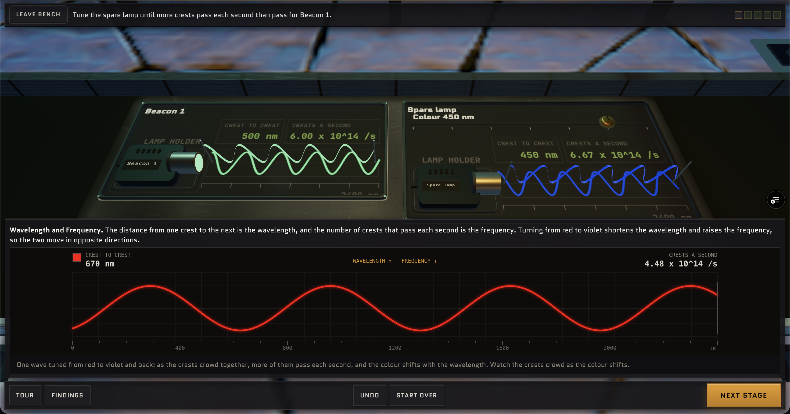
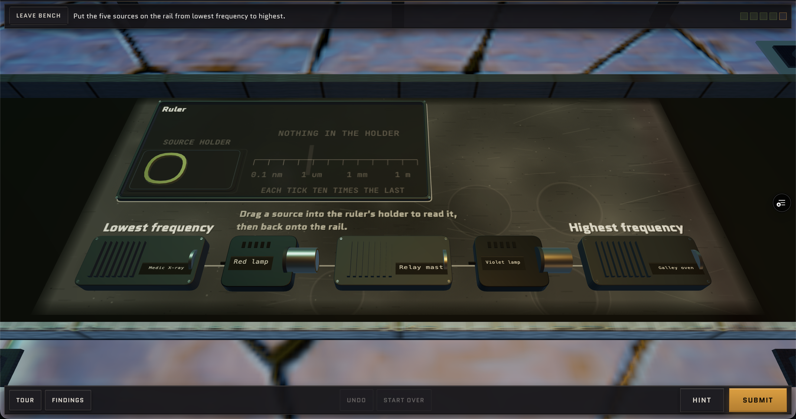
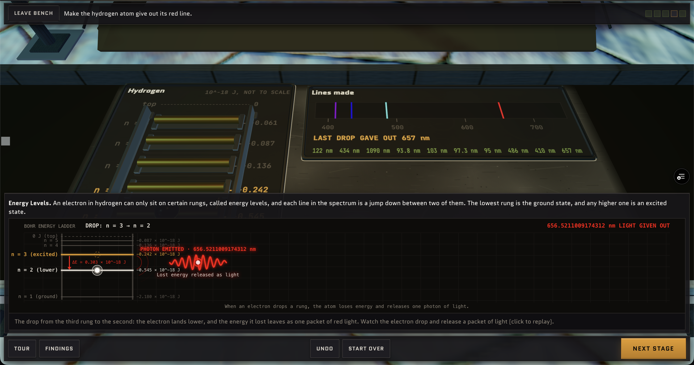
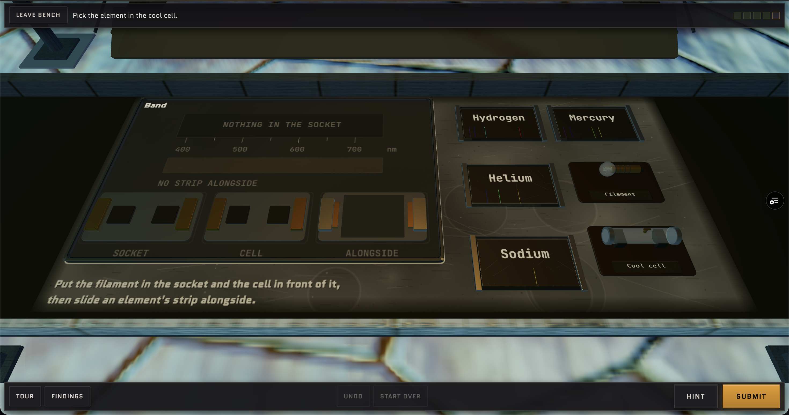
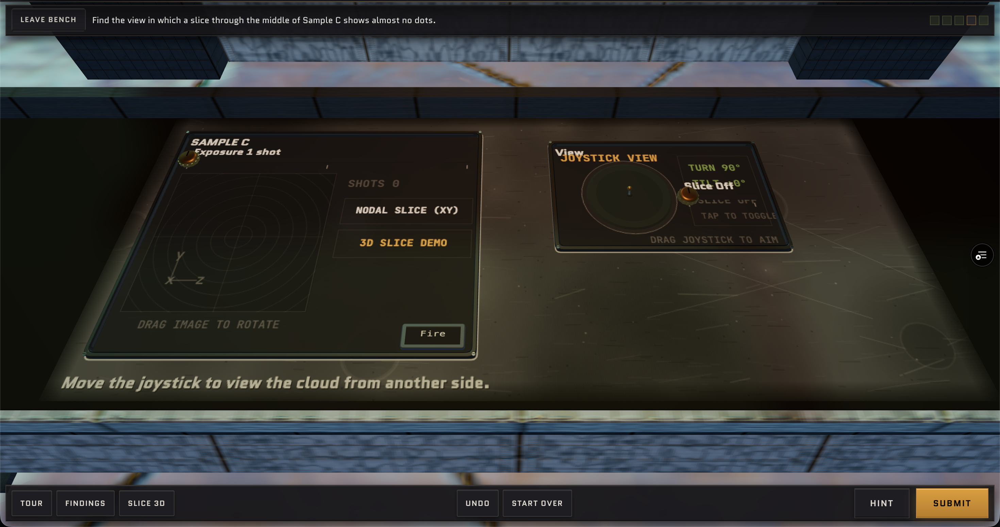
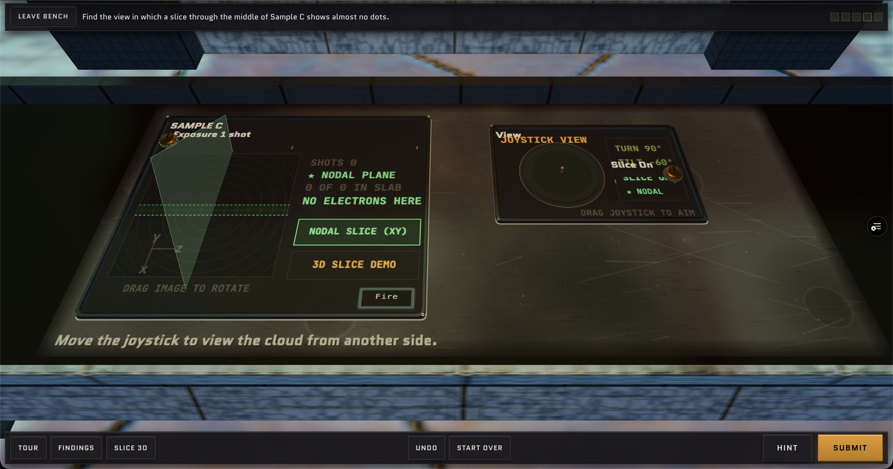

# Feedback from user audit 2026-10-22

This contains user feedback from the second audit of the website.

Remove the vertical waves on this Lanternfall bench -  - leave only the waves in the plane of the table. Do this for all the Lanternfall benches.

On this bench,  instead of "Speed (x 10^8 m/s)" do "Speed _ x 10^8 m/s" and put the user's selection in that blank.

On this explanation, , in the 3D viewer label the wavelength of the wave.

On this bench, , remove "EACH TICK TEN TIMES THE LAST".

On this bench, remove the word "Photocell" on the bench and change "FREED PER SECOND" to "ELECTRONS PER SECOND" on the bench. Do the same with the other benches in this quest.

On this explanation for this bench, , remove "Bohr Energy Ladder" and "_____ light given out".

For this bench, , replace "Put the filament in the socket and the cell in front of it, then slide an element's strip alongside" to "Put the filament in the socket, the cool cell in front of it, then find which element is in the cell".

This bench is a disaster - . Please completely rework the bench so it is actually intuitive to use, text doesn't overlap, and enlarge the joystick and make sure it actually works. Remoe "Nodal slice", "3D slice demo" and all that fancy terminology - you are throwing too much at the user at once. Replace "Exposure 1 shot" with "Number of shots: 1". Make sure I can rotate continuously using the joystick or by dragging, instead of being confined to set values. . The stage looks really bad in general. Same thing with the next bench - rework the joystick and controls.

