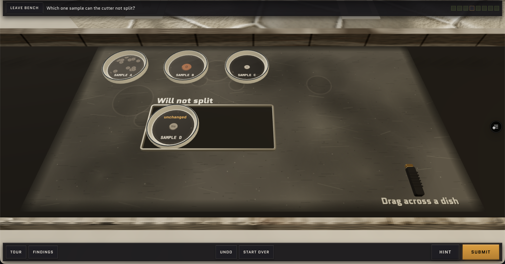
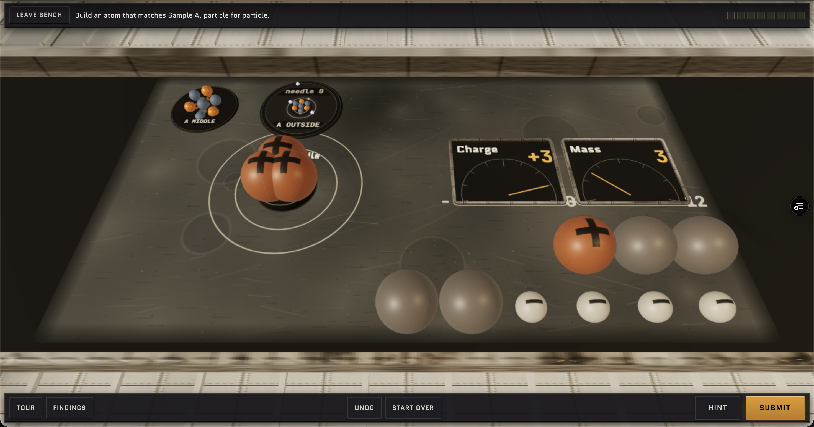
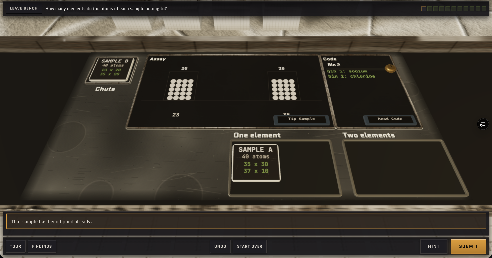
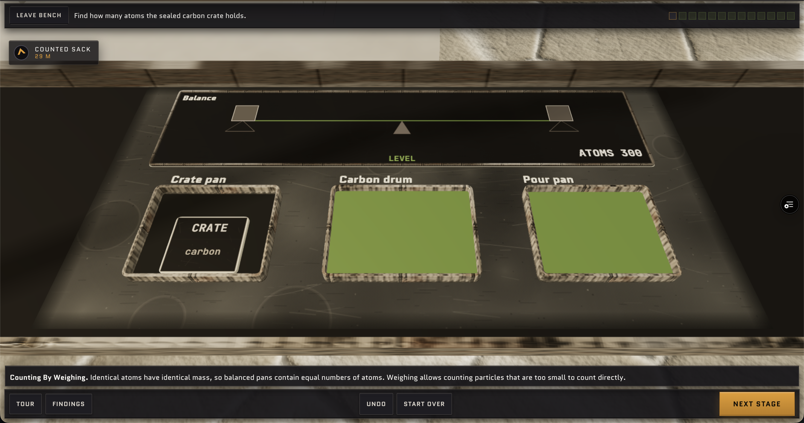
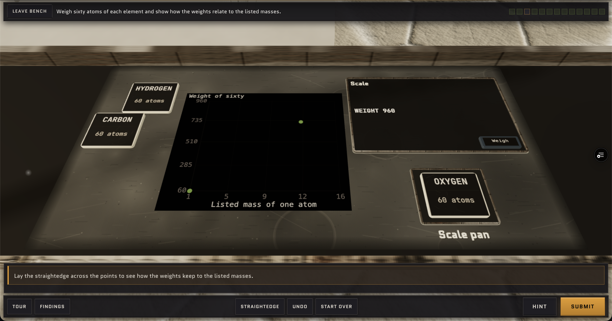
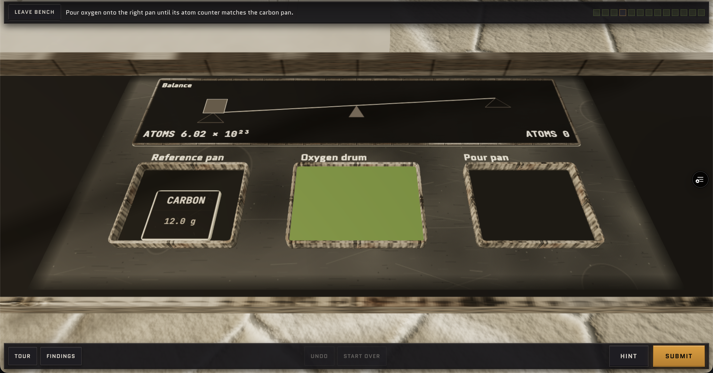
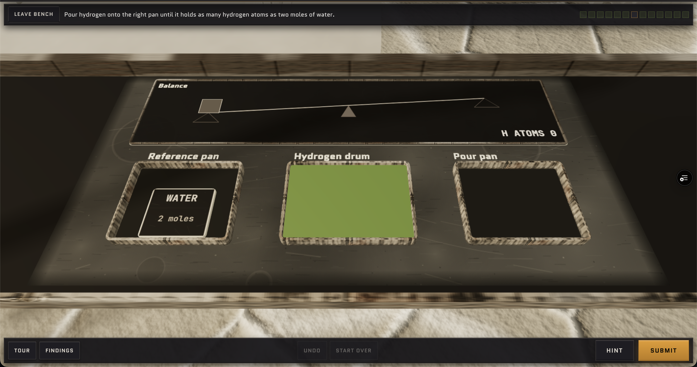
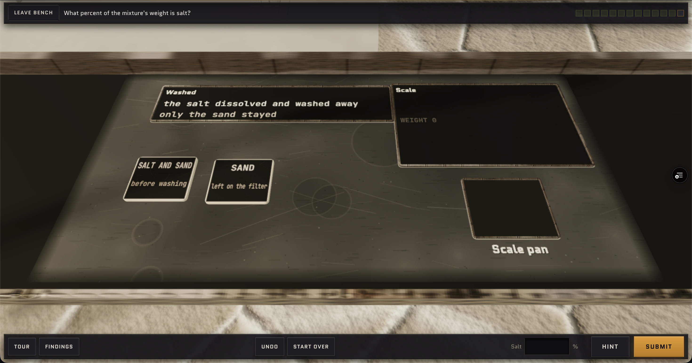
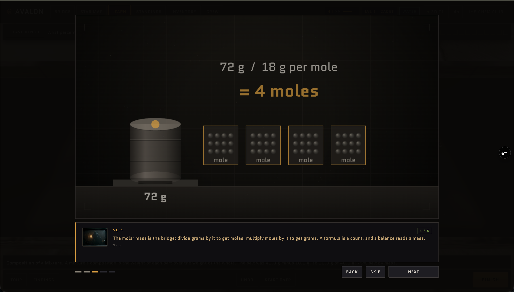

# Feedback from user audit 2026-11-01

This document contains feedback from the user audit on 2026-11-01.

## Tallow

**Status: Implemented on 2026-11-01.**

 - move the text "Drag over a dish" so it isn't hidden under the handle. This goes for all the benches on this quest.

 The reader should not show the element name, only the mass - change "reader" to "scale".

 Remove the word "unchanged" - it is the answer giveaway.

 For this stage, have the user actually fire the particles and observe what happens. Then, they have to sort.

 Sample A B and C all look very weird - there are electrons rotating and electrons printed on the picture. Remove the electrons printed on the 2D picture - keep the moving ones. Same goes for the rest of the quest.

 For the element cards, remove the word "protons". The user has to guess.

 Put the numbers 1, 2, 13...18 at the top, above the groups, and label the numbers "Group".

 Rearrange the layout so the sample A doesn't overlap with the shells. Also, shrink the protons and neutrons considerably, so that when I build A they all actually fit in the center. Same goes for the rest of the bench.

 Remove this stage - it is redundant. Make sure once the previous stage finishes, the Vess debrief pops up.

 Instead of having a separate window for code, put "Read element" next to the "Tip Sample" button, and when clicked it shows the elements of each pile. Also, there are just 4 random numbers on the Assay display - please label one row "mass" and the other "amount".

 Instead of labeling "Sample A" and "Sample B", label it "Chlorine Sample A" and "Chlorine Sample B".

 For this quest, move the first two stages to the previous quest (q4). Then, remove the rest of the stages (basically, delete the quest). At the end of q4, there should be a worked problem that introduces the idea of average atomic masses (what is displayed on the periodic table).

 Remove this stage of the quest.

 Split this stage up into two parts - the first part should be predicting the atomic mass of methane (have the user enter a number), and the second part is confirming the analysis.

 Remove this stage.

 Remove this stage.

 Remove this stage.

 Rework this stage to more intuitively introduce the concept of counting the number of particles by weighing it (introduce the mole here). Perhaps switch to a worked problem here?

 Remove this stage.

 I really don't like this balance setup - remove it from this quest and figure out a better and more intuitive way to do things, especially for this stage - for example, just ask if there is this many grams of carbon and this many grams of hydrogen, how many hydrogens join each carbon?

 Make sure to give me the atomic masses of hydrogen and carbon here.

 Remove this stage.

 Rephrase this part of the Vess debrief - it is really confusing. Instead, say "If there are 72 grams of water and each mole weighs 18 grams, then there are 4 moles of water.

For worked problems and the problems at the end of each quest, don't put it in a tiny window on the left side overlaying the 3D world. Cut out the 3D world and dedicate the whole screen to the display - make it look good, clean, minimalistic, and simple.

