# User feedback from 2026 November 22 audit

## Ligar

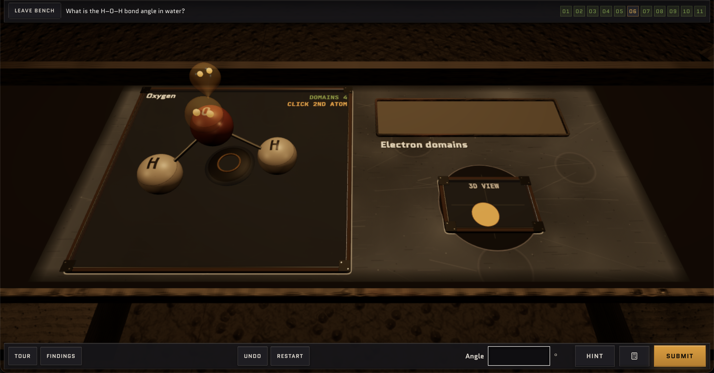 For this kit, how can I measure an angle by only clicking two atoms? I need to click three atoms. Also, the angle measurement label is on the flat bench - it should be suspended in midair to properly mark the correct angle it is measuring.

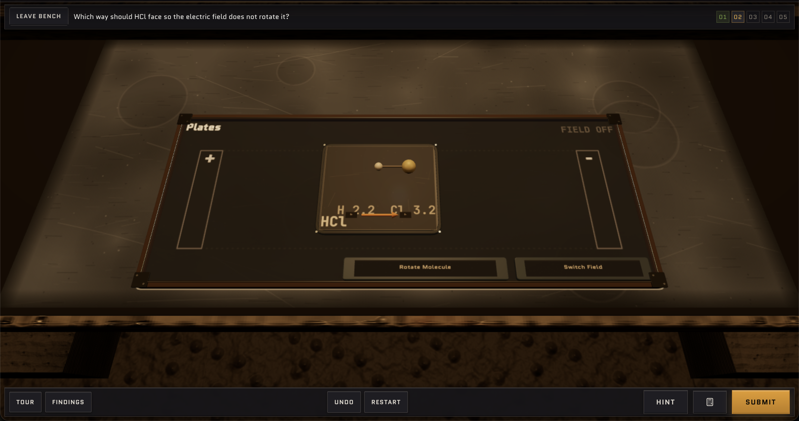 The delta plus and minus symbols are not visible - write them on the card directly. Also, the arrow and symbols should be next to the molecule, not at the bottom of the card.

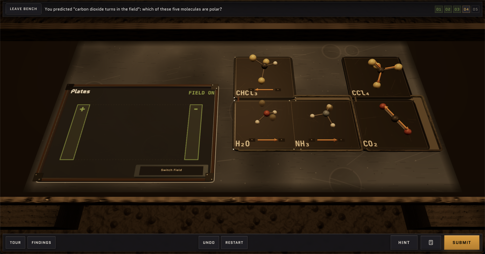 Expand the trays so they actually fit the cards.

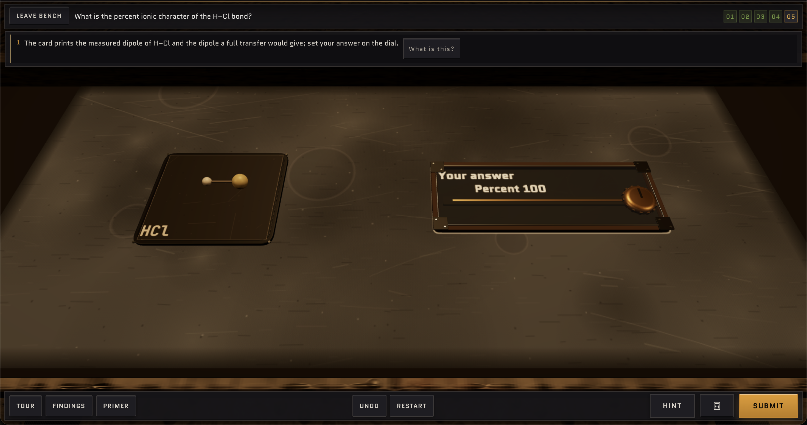 This stage makes no sense - I don't see anything I can use to determine the percent ionic character. The second part of the tour talks about a probe, but there isn't a probe... Also, the button "What is this" looks really bad visually because it isn't aligned, and makes the hint larger. Please make this actually look good.

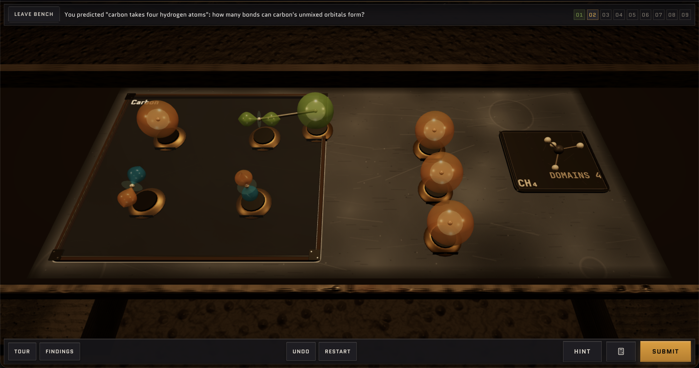 Please make sure the prompt for this stage describes what I am supposed to do.

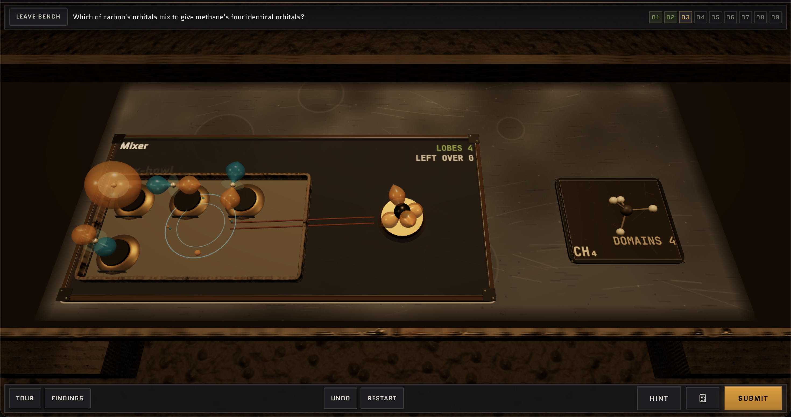 The mixer looks really confusing - perhaps remove the blue ring, and replace it with a black box on the red lines. Basically, I put the orbitals into the tray, and there should be a "mix" button I can press, which does some animation that mixes all the orbitals together.

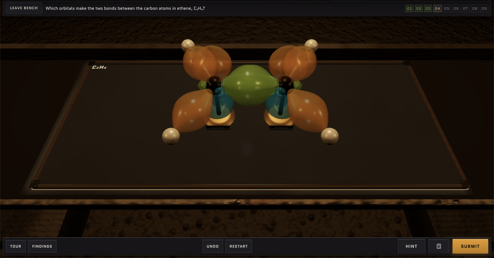 Again, this prompt isn't very clear what I am supposed to do, and neither does the prompt for the previous stage (the mixing). For this prompt, make it clear ethene has a double bond.

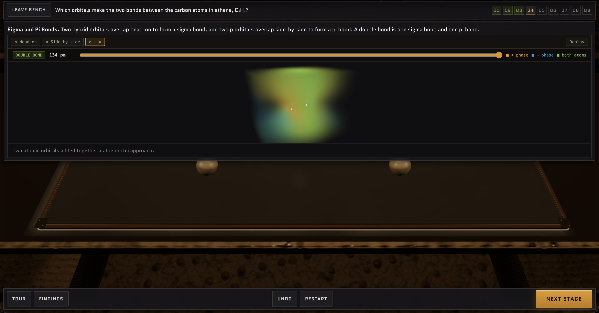 Please fix this explainer so that it is an animation rather than an interactive (no text or buttons or sliders). The animation shouldn't show this weird thing - I don't get what's going on. I should see the orbital surfaces slowly come together and mix. I should see two labels - sigma and pi. 

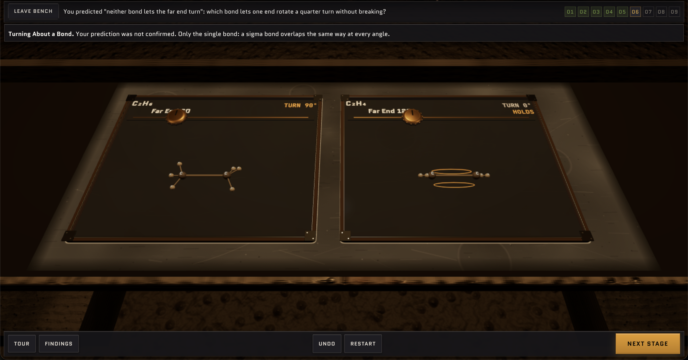 For this stage, the prompt should say "You predicted _____: Turn both bonds 90 degrees and see what happens".

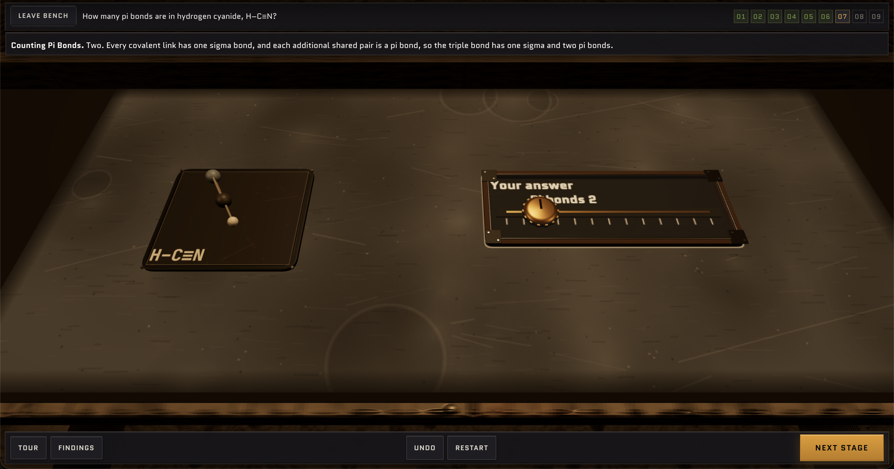 For this stage, instead of showing a ball-and-stick model of HCN, show the model with the orbitals - fuse the p orbitals into a pi bond. However, make sure it is visually clear there is one sigma bond and 2 pi bonds between C and N.

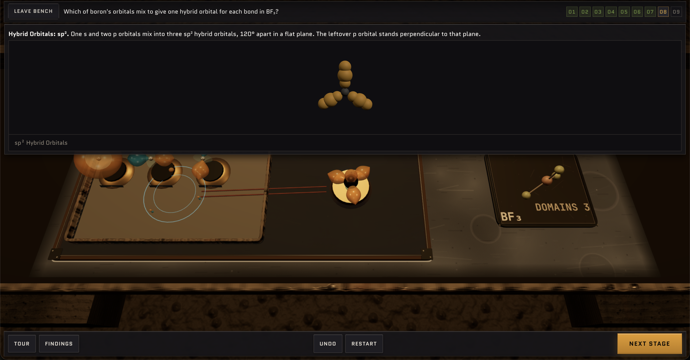 Make sure the explainer animation shows the unmixed p orbital, and labels it as such (label the 3 sp2 mixed bonds too).

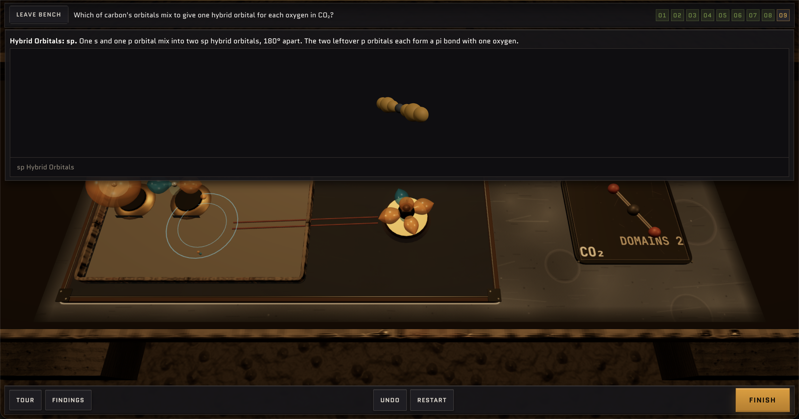 Make sure this explainer animation shows all the orbitals of CO2 - label them with short labels.

Make sure in the opening scene for the MO quest, the person says "I heard I can use magnets to detect if there is oxygen in the pipe. How would I do this?"

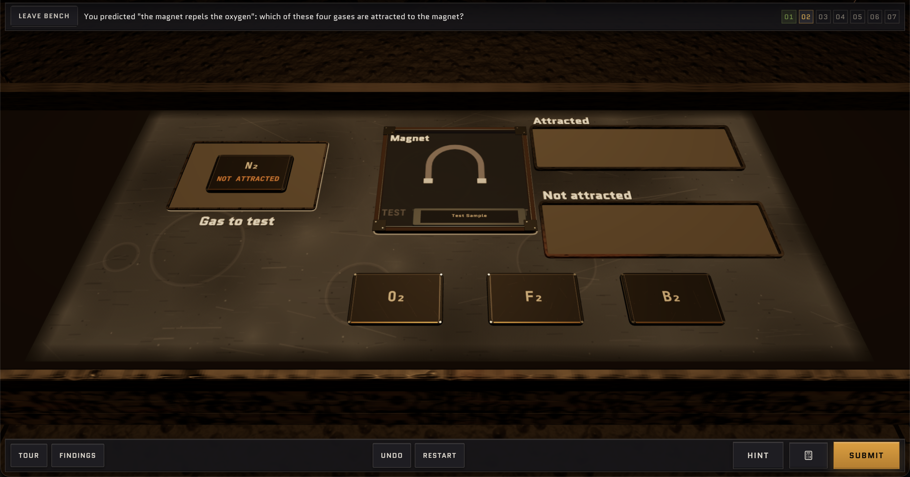 Update this kit to include animations and look more realistic - for example, put the N2 in front of the magnet, and after I press the button the N2 should either be repelled or attracted (visually move closer to or farther away from) the magnet.

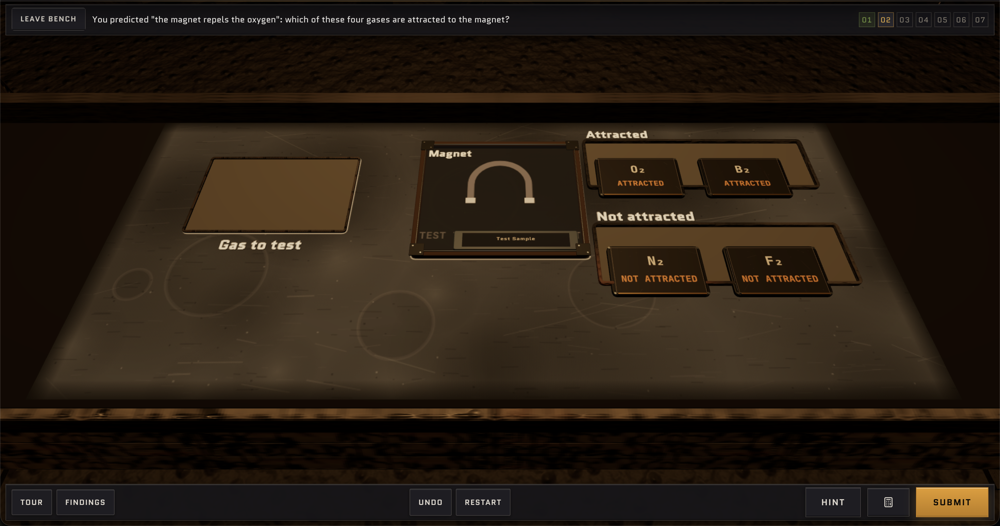 Make sure the cards actually go in the trays.

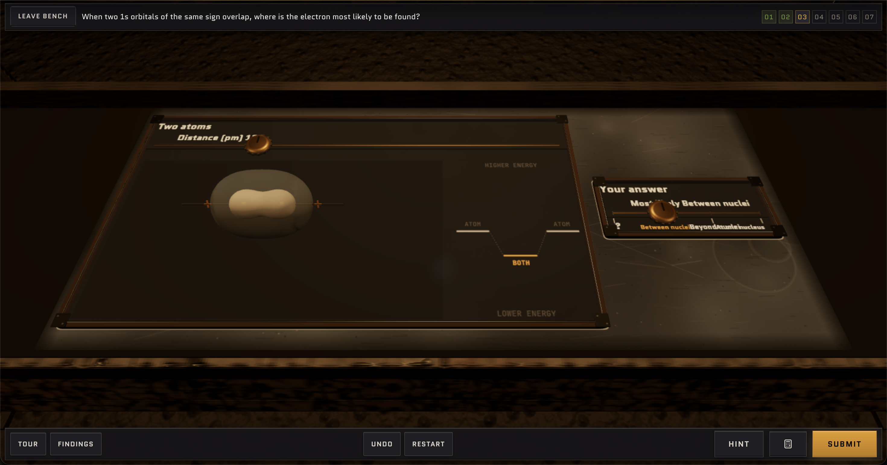 Fix the text overlap next to the dial - there is no need for the text below the number line if the text is also above the line.

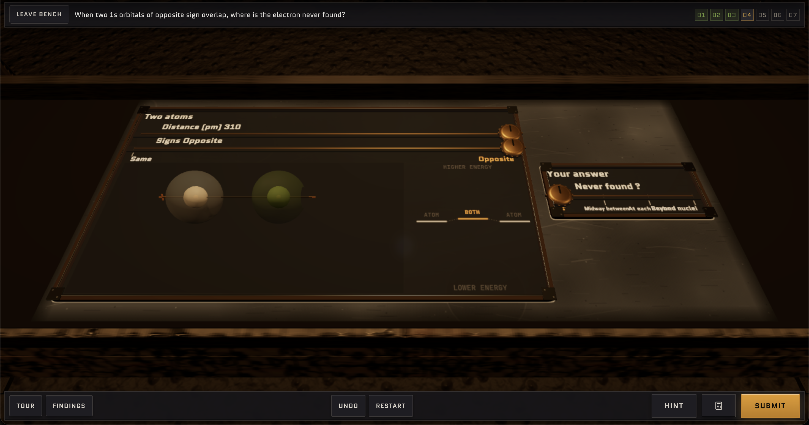 For this stage, when I move the atoms closer together, the orbitals appear to shrink - instead, they should slowly morph into antibonding orbitals (electron density away from the center and towards each end).

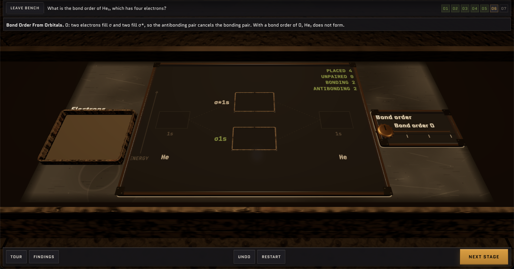 Make sure the electrons actually look like electrons and not like icosahedrons - also, when I drag the electrons onto the slots they vanish.

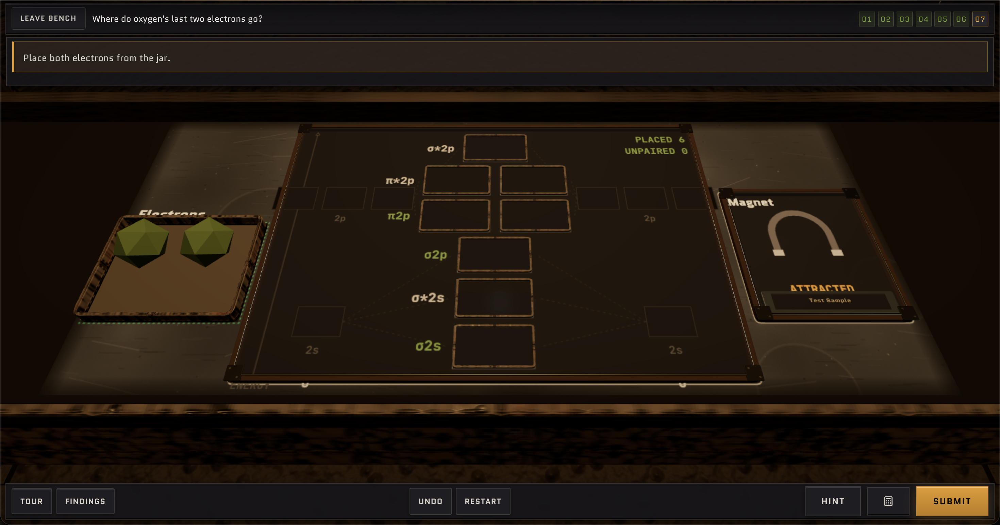 I can't move the electrons out of the tray here.

