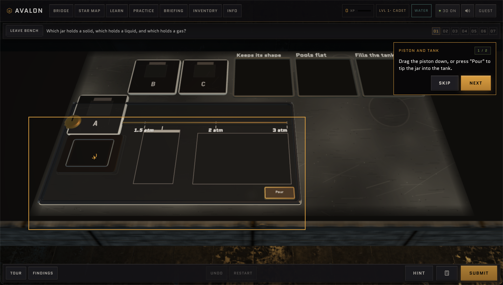
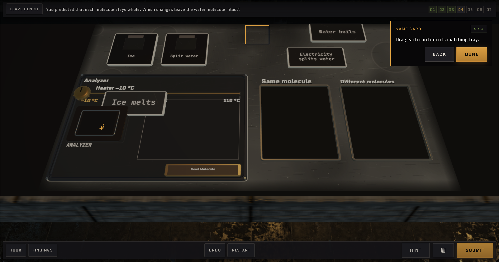

# Feedback from user audit 2026 November 27

 The tour animation for this stage shows a pointer dragging the card, but the card glitches. This happens for many tours in this world. For this tour specifically, Instead of saying "lay it in a labeled box", say "sort it".

 For this stage, have the user pair up images/jars instead of dragging images into confusing trays.

 For this stage, remove the iron molecules and all references to iron - it isn't necessary here. Also, instead of balls, the animation needs to show tiny water molecules, so the user can see the bonds don't break.

 For this stage of the tour, the animation should drag the card into the tray, not into the workstation.

