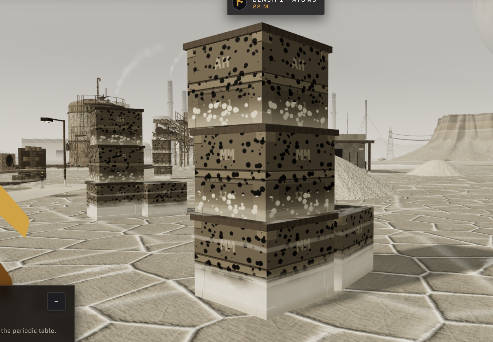
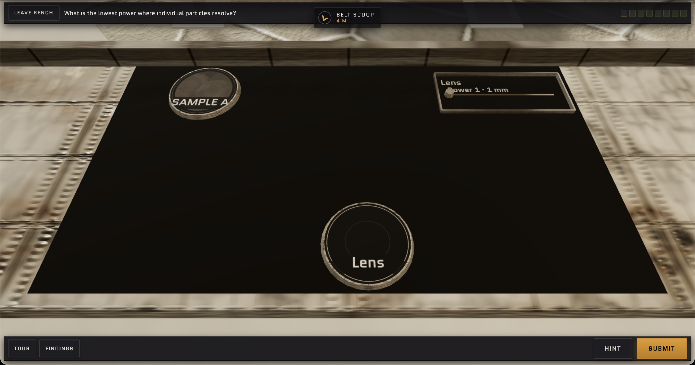
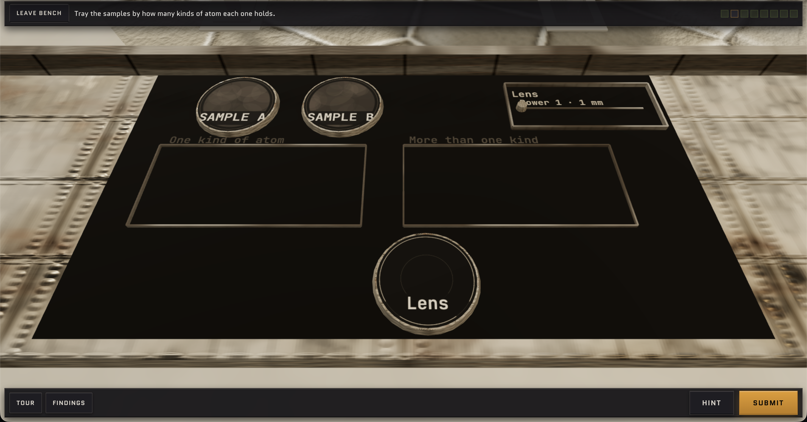
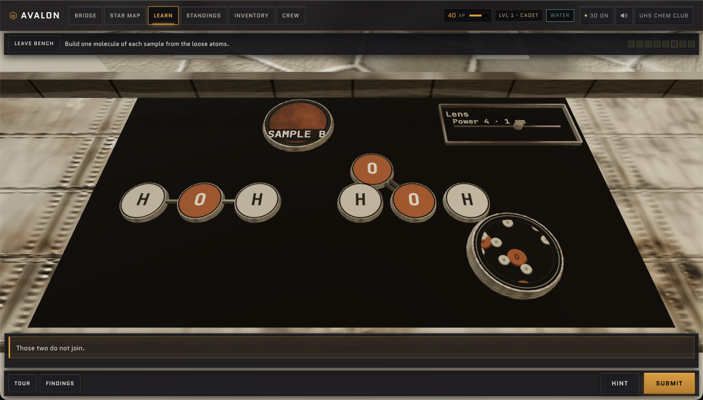
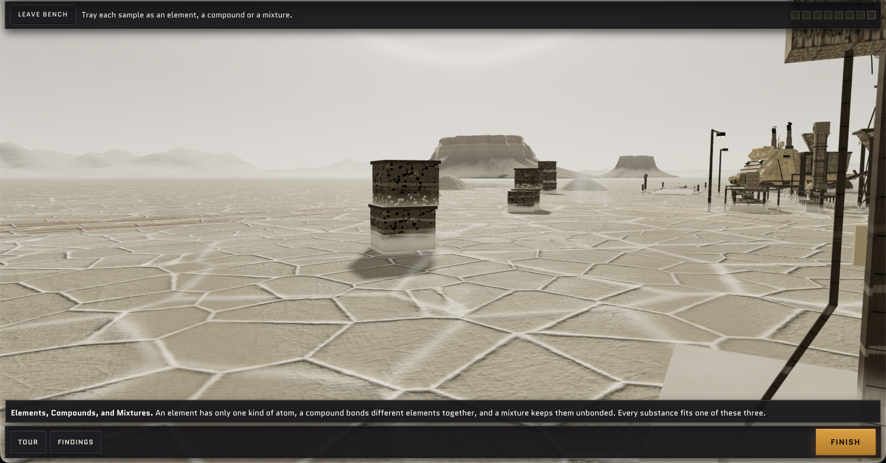
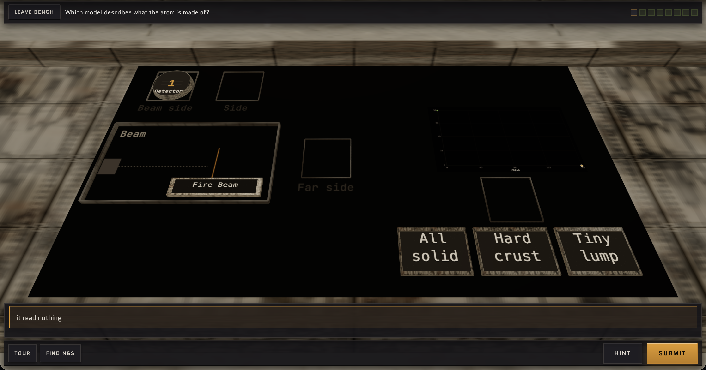
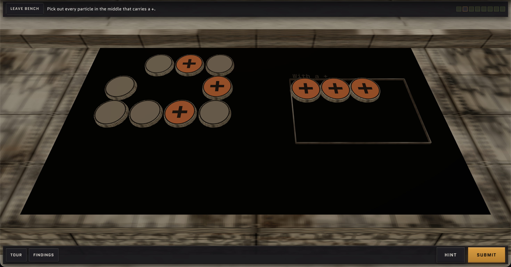

# User audit 2026-10-09

This document contains all the feedback from a user audit of the website.

## General Feedback

Wherever possible, please add 3D visualizations - this video game's advantage is its 3D modality, so as much as possible (when helpful) 3D visualizations should be used instead of 2D ones. However, don't add 3D visualizations where it would just make things weird - for example, in Tallow, keep the lens display 2D. Right now, most of the quests are 2D in a 3D world.

The benches don't look aesthetically pleasing. Layout is weird, it doesn't look that realistic, and it kind of looks like a bunch of squares with weird textures fitted on top.

Stop using confusing terminology.

Where possible, insert explanations that help the user navigate and use instruments. Right now, I can only pass the stages because I have pre-existing knowledge about how the video game works.

In general, trying to figure out this game is harder than actually learning the chemistry - I shouldn't be devoting my brainpower to figuring out how the game works - any idiot should be able to do it.

## Ship

The star map should only display planets, names, and rings - no "Act ___" or light-year measurements. Also, scatter the planets so they don't form such a nice pattern.

## Tallow

These crates don't look realistic - they should be more worn. They feel too neo. See Figure 1.

On the first Tallow bench, the question is unclear. What does "resolve" mean? Also, the layout of the bench is really weird - it doesn't look aesthetically pleasing, and there are lots of overlaps from my point of view. Please space out the instruments so they are aesthetically pleasing layout-wise and don't have overlaps from this point of view - don't shift the point of view, just shift the objects around to remove overlap. See Figure 2.

Again, more overlap (Figure 3). Make all of these benches more aestheticall pleasing. On this stage specifically, rephrase "Tray the samples" to "Sort the samples". The trays also don't look like trays. Plus, "Sample A" and "Sample B" are partailly cut off.

A few stages later, where we see the "cutter", it doesn't look like a cutter, and I have no clue how to operate it.

On the stage in Figure 4, I can't actually pick up the lens once i've placed it on Sample A - if I try to pick it up, I end up picking up Sample A instead. So I can't pick the lens up to Sample B. Also, if I mess up I have no way to edit - for example, if I make an O=O bond, I can't make it an O-O bond.

Later on, with the shaker, same problem as the cutter - it is unintuitive to use, doesn't look realistic, and I have no clue how to do it or what it means when it separates into multiple layers vs a single layer. This is just adding unnecessary complexity.

After I finish the bench, and click "Close channel", the stage UI should vanish (see Figure 5). I shouldn't see the stage text bar on the top or the buttons bar on the bottom. Clicking "Leave Bench" when I've already left the bench also doesn't close these. Actually, clicking none of the buttons (learn, bridge, etc) actually works.

On the next bench, Figure 6's setup is so confusing - how it actually works is really unintuitive. I shouldn't have to move the detector around - I'm pretty sure we can get multiple detectors. This kind of added complexity only messes up things more. Also, what is "all solid" vs "hard crust" vs "tiny lump"? That doesn't make any sense. And how do I submit my answers?

What is the purpose of Figure 7's bench? I don't need to waste my time moving + to one side into the tray - this is busywork that doesn't actually contribute to my understanding of chemistry.

On the next stage, with the needle - again, I have no clue what the needle does.
